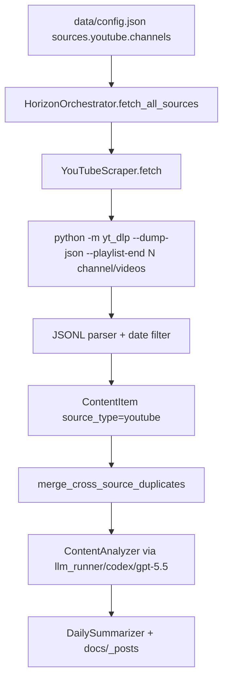

# YouTube Source Provider Plan

## Goal

Add a first-class YouTube source provider so Horizon can track YouTube channels even when YouTube's advertised RSS URL returns 404, using a project-owned `yt-dlp` subprocess path with deterministic tests and live verification.

## Mission Frame

- **Mission:** Make `https://www.youtube.com/channel/UCGq-a57w-aPwyi3pW7XLiHw` configurable as a durable Horizon source and fetch its latest videos as normal `ContentItem` records.
- **Evidence of Success:** Unit tests prove config parsing, subprocess parsing, date filtering, orchestrator integration, MCP source filtering, and docs examples. A live opt-in fetch proves the given channel returns at least one item with title, URL, channel metadata, and upload date. Browser/Jekyll proof remains downstream and should use normal Horizon summaries, not a custom verification page.
- **Boundaries:** Do not pretend this channel works through RSS while its feed returns 404. Do not add Apify for YouTube. Do not require a YouTube API key. Do not download video/audio. Do not scrape the rendered browser DOM as the production path. Do not modify `llm-runner` or AI provider behavior.

## Existing Plan Decision

Existing plan found: `docs/plans/2026-05-08-llm-runner-provider.md`.

Decision: do not reuse it. That plan covers AI provider routing through `llm-runner`; this plan covers source ingestion. The only inherited constraint is that live AI scoring, when run, should continue using `llm_runner / codex / gpt-5.5` from `data/config.json`.

## Design Step

### Depth

Depth: deep

Reason: this changes schema, a new scraper, orchestrator dispatch, MCP source filtering, setup/config surfaces, docs, dependency management, tests, and live service verification. It also changes a core assumption that RSS is sufficient for YouTube-like sources.

### Gate

Gate: triggered

Condition check:

- 2+ layers/files changed? yes. Models, scraper, orchestrator, MCP, setup, docs, tests, config examples, dependencies.
- DB/API/infra rollback-hard decision? no DB migration, but dependency/runtime contract changes through `yt-dlp`.
- Existing assumption changed? yes. YouTube channels must be first-class sources instead of RSS-only feeds.

Implementation must wait for explicit approval. This document is plan-only.

## Architecture

### Recommended Approach: First-Class YouTube Provider

Add `SourceType.YOUTUBE`, `YouTubeChannelConfig`, `YouTubeConfig`, and `YouTubeScraper`. The scraper invokes the project dependency with:

```bash
python -m yt_dlp --dump-json --playlist-end <fetch_limit> <channel-url>/videos
```

It parses JSON Lines from stdout into `ContentItem` records. It must never download media; it only reads metadata. It should use `asyncio.create_subprocess_exec`, not shell strings.

The scraper should prefer `timestamp`, then `upload_date`, then skip the item if neither is present. In the live probe for the requested channel, `yt-dlp --dump-json --playlist-end 1` returned:

```json
{
  "id": "BTJGr78-zyw",
  "title": "Professor Jiang: World War 3 Has Already Begun, Let Me Explain!",
  "timestamp": 1778137208,
  "upload_date": "20260507",
  "channel": "The Diary Of A CEO",
  "channel_id": "UCGq-a57w-aPwyi3pW7XLiHw",
  "webpage_url": "https://www.youtube.com/watch?v=BTJGr78-zyw"
}
```

### Alternatives Considered

#### A. RSS-only

Pros: no new dependency, current RSS scraper already exists.

Cons: the target channel advertises an RSS URL but the URL currently returns 404. This fails the user's concrete source. It also leaves no durable fallback for channels where YouTube metadata and RSS disagree.

Failure scenario: the config accepts the RSS URL, Horizon silently fetches zero items, and the operator sees no actionable source error.

#### B. YouTube Data API

Pros: official API, structured metadata, stable quota model.

Cons: requires Google Cloud setup, API key ownership, quotas, and extra operator burden. This conflicts with the local-first direction used for the current Horizon setup.

Failure scenario: users cannot add simple channels without credential provisioning, and the setup burden becomes higher than RSS/HN/GeekNews.

#### C. Browser/Playwright scraping

Pros: could reuse a logged-in local browser.

Cons: fragile, slow, hard to run headless in scheduled jobs, and mixes verification browser tooling into production ingestion.

Failure scenario: login/session/anti-bot UI changes break automated runs.

### Data Flow



### Error Handling

- Missing `yt_dlp` module: log a warning and return `[]`; `validate_config` should surface a dependency check result when `sources.youtube.enabled` is true.
- Subprocess timeout: kill process, log command label, return `[]`.
- Non-zero exit: log stderr excerpt, return `[]`.
- Invalid JSON line: skip that line, log debug with video/channel context.
- Missing publication date: skip item to avoid stale videos bypassing `since`.
- Empty channel list: return `[]` without warning.

## Designer Predictions

Expected risks:

1. `yt-dlp` metadata shape varies by channel or YouTube rollout. Probability: medium. Mitigation: parse `timestamp`, `upload_date`, and `webpage_url` defensively; contract tests cover both timestamp and upload_date shapes.
2. `yt-dlp` can be slow compared with RSS. Probability: medium. Mitigation: default `fetch_limit` low, add `timeout_sec`, and run one subprocess per channel sequentially first.
3. Source filtering drift in MCP. Probability: medium. Mitigation: add `youtube` to `VALID_SOURCES`, `apply_source_filter`, `get_enabled_sources`, and smoke tests.
4. Setup wizard count/merge misses YouTube. Probability: medium. Mitigation: explicit wizard tasks and tests.
5. Live YouTube fetch may fail due to network or YouTube throttling. Probability: low to medium. Mitigation: classify live fetch as final-refresh evidence; contract tests remain blocking.

Previous similar work:

- GeekNews exposed a root assumption bug: query strings were removed during dedupe, collapsing `topic?id=...` items. This plan therefore includes native source identity tests and live fetched count checks, not just "page loads" checks.
- `llm-runner` integration separated contract proof from provider-owned live readiness. This plan uses the same split: unit/subprocess contract is blocking; live YouTube network proof is final refresh.

## Tech Stack

- Python 3.11+
- Pydantic v2
- `asyncio.create_subprocess_exec`
- `yt-dlp` Python package, invoked as `python -m yt_dlp`
- Existing `ContentItem`, `BaseScraper`, `HorizonOrchestrator`, `HorizonPipelineService`
- pytest with `tmp_path`, monkeypatch, and fake subprocess helpers

## Implementation Tasks

### Task 1: Add schema and source type

Files:

- `src/models.py`
- `data/config.example.json`

Changes:

1. Add enum member:

```python
class SourceType(str, Enum):
    GITHUB = "github"
    HACKERNEWS = "hackernews"
    RSS = "rss"
    REDDIT = "reddit"
    TELEGRAM = "telegram"
    TWITTER = "twitter"
    YOUTUBE = "youtube"
```

2. Add config models:

```python
class YouTubeChannelConfig(BaseModel):
    """Configuration for monitoring a YouTube channel."""
    name: str
    url: HttpUrl
    enabled: bool = True
    fetch_limit: int = 5
    category: Optional[str] = None


class YouTubeConfig(BaseModel):
    """YouTube source configuration via yt-dlp metadata extraction."""
    enabled: bool = False
    channels: List[YouTubeChannelConfig] = Field(default_factory=list)
    command: str = "yt-dlp"
    timeout_sec: float = 120.0
```

3. Add to `SourcesConfig`:

```python
youtube: YouTubeConfig = Field(default_factory=YouTubeConfig)
```

4. Add disabled example to `data/config.example.json`:

```json
"youtube": {
  "enabled": false,
  "channels": [
    {
      "name": "The Diary Of A CEO",
      "url": "https://www.youtube.com/channel/UCGq-a57w-aPwyi3pW7XLiHw",
      "enabled": true,
      "fetch_limit": 5,
      "category": "interviews"
    }
  ],
  "command": "yt-dlp",
  "timeout_sec": 120
}
```

Verification:

```bash
uv run python - <<'PY'
from src.models import Config
import json
payload = json.load(open("data/config.example.json"))
cfg = Config.model_validate(payload)
print(cfg.sources.youtube.enabled)
print(cfg.sources.youtube.channels[0].name)
PY
```

Expected output:

```text
False
The Diary Of A CEO
```

### Task 2: Add `yt-dlp` dependency

File:

- `pyproject.toml`

Change:

Add:

```toml
"yt-dlp>=2026.3.17",
```

Then refresh lock:

```bash
uv lock
```

Verification:

```bash
uv run python -m yt_dlp --version
```

Expected output:

```text
2026.03.17
```

Any newer version is acceptable if `uv lock` resolves it and the live metadata command still works.

### Task 3: Implement `YouTubeScraper`

File:

- `src/scrapers/youtube.py`

Required implementation shape:

```python
"""YouTube channel scraper using yt-dlp metadata extraction."""

from __future__ import annotations

import asyncio
import json
import logging
import sys
from datetime import datetime, timezone
from typing import List, Optional
from urllib.parse import urlparse

from .base import BaseScraper
from ..models import ContentItem, SourceType, YouTubeChannelConfig, YouTubeConfig

logger = logging.getLogger(__name__)


class YouTubeScraper(BaseScraper):
    """Fetch YouTube channel videos via yt-dlp without downloading media."""

    def __init__(self, config: YouTubeConfig):
        super().__init__(config)
        self.config = config

    async def fetch(self, since: datetime) -> List[ContentItem]:
        if not self.config.enabled:
            return []

        items: list[ContentItem] = []
        for channel in self.config.channels:
            if not channel.enabled:
                continue
            items.extend(await self._fetch_channel(channel, since))
        return items

    async def _fetch_channel(self, channel: YouTubeChannelConfig, since: datetime) -> List[ContentItem]:
        cmd = [
            sys.executable,
            "-m",
            "yt_dlp",
            "--dump-json",
            "--playlist-end",
            str(max(channel.fetch_limit, 1)),
            self._videos_url(str(channel.url)),
        ]
        try:
            process = await asyncio.create_subprocess_exec(
                *cmd,
                stdout=asyncio.subprocess.PIPE,
                stderr=asyncio.subprocess.PIPE,
            )
            stdout, stderr = await asyncio.wait_for(
                process.communicate(),
                timeout=max(self.config.timeout_sec, 1.0),
            )
        except (asyncio.TimeoutError, FileNotFoundError) as exc:
            logger.warning("Error fetching YouTube channel %s: %s", channel.name, exc)
            return []

        if process.returncode != 0:
            logger.warning(
                "yt-dlp failed for YouTube channel %s: %s",
                channel.name,
                stderr.decode("utf-8", errors="replace")[:500],
            )
            return []

        items: list[ContentItem] = []
        for line in stdout.decode("utf-8", errors="replace").splitlines():
            if not line.strip():
                continue
            try:
                raw = json.loads(line)
            except json.JSONDecodeError:
                logger.debug("Skipping invalid yt-dlp JSON line for %s", channel.name)
                continue
            item = self._parse_item(raw, channel, since)
            if item:
                items.append(item)
        return items

    def _parse_item(
        self,
        raw: dict,
        channel: YouTubeChannelConfig,
        since: datetime,
    ) -> Optional[ContentItem]:
        video_id = str(raw.get("id") or "")
        title = str(raw.get("title") or "").strip()
        published_at = self._published_at(raw)
        url = raw.get("webpage_url") or raw.get("url")

        if not video_id or not title or not published_at or not url:
            return None
        if published_at < since:
            return None

        return ContentItem(
            id=self._generate_id(SourceType.YOUTUBE.value, "video", video_id),
            source_type=SourceType.YOUTUBE,
            title=title,
            url=url,
            content=raw.get("description") or title,
            author=raw.get("channel") or channel.name,
            published_at=published_at,
            metadata={
                "channel_name": raw.get("channel") or channel.name,
                "channel_id": raw.get("channel_id"),
                "channel_url": str(channel.url),
                "duration": raw.get("duration"),
                "view_count": raw.get("view_count"),
                "category": channel.category,
                "uploader_id": raw.get("uploader_id"),
                "upload_date": raw.get("upload_date"),
            },
        )

    @staticmethod
    def _published_at(raw: dict) -> Optional[datetime]:
        timestamp = raw.get("timestamp") or raw.get("release_timestamp")
        if timestamp:
            return datetime.fromtimestamp(int(timestamp), tz=timezone.utc)

        upload_date = raw.get("upload_date")
        if upload_date:
            return datetime.strptime(str(upload_date), "%Y%m%d").replace(tzinfo=timezone.utc)

        return None

    @staticmethod
    def _videos_url(url: str) -> str:
        path = urlparse(url).path.rstrip("/")
        if path.endswith("/videos"):
            return url
        return url.rstrip("/") + "/videos"
```

Verification:

```bash
uv run pytest tests/test_youtube.py -q
```

Expected output:

```text
... [all tests pass]
```

### Task 4: Add YouTube scraper tests

File:

- `tests/test_youtube.py`

Required tests:

```python
import asyncio
import json
from datetime import datetime, timedelta, timezone

from src.models import YouTubeChannelConfig, YouTubeConfig
from src.scrapers.youtube import YouTubeScraper


def _config(**kwargs):
    defaults = {
        "enabled": True,
        "channels": [
            YouTubeChannelConfig(
                name="The Diary Of A CEO",
                url="https://www.youtube.com/channel/UCGq-a57w-aPwyi3pW7XLiHw",
                fetch_limit=2,
                category="interviews",
            )
        ],
        "timeout_sec": 5,
    }
    defaults.update(kwargs)
    return YouTubeConfig(**defaults)


def _raw(video_id="abc123", title="Video title", timestamp=None, upload_date="20260507"):
    return {
        "id": video_id,
        "title": title,
        "timestamp": timestamp,
        "upload_date": upload_date,
        "webpage_url": f"https://www.youtube.com/watch?v={video_id}",
        "description": "Video description",
        "channel": "The Diary Of A CEO",
        "channel_id": "UCGq-a57w-aPwyi3pW7XLiHw",
        "duration": 123,
        "view_count": 456,
    }


def test_disabled_returns_empty():
    scraper = YouTubeScraper(_config(enabled=False))
    result = asyncio.run(scraper.fetch(datetime.now(timezone.utc)))
    assert result == []


def test_parse_item_from_upload_date():
    scraper = YouTubeScraper(_config())
    channel = scraper.config.channels[0]
    item = scraper._parse_item(_raw(), channel, datetime(2026, 5, 1, tzinfo=timezone.utc))
    assert item is not None
    assert item.source_type.value == "youtube"
    assert item.id == "youtube:video:abc123"
    assert str(item.url) == "https://www.youtube.com/watch?v=abc123"
    assert item.metadata["channel_name"] == "The Diary Of A CEO"
    assert item.metadata["category"] == "interviews"


def test_parse_item_from_timestamp():
    scraper = YouTubeScraper(_config())
    channel = scraper.config.channels[0]
    item = scraper._parse_item(
        _raw(timestamp=1778137208, upload_date=None),
        channel,
        datetime(2026, 5, 1, tzinfo=timezone.utc),
    )
    assert item is not None
    assert item.published_at.year == 2026


def test_filters_old_videos():
    scraper = YouTubeScraper(_config())
    channel = scraper.config.channels[0]
    item = scraper._parse_item(_raw(upload_date="20240101"), channel, datetime(2026, 5, 1, tzinfo=timezone.utc))
    assert item is None


def test_videos_url_appends_videos_tab():
    assert YouTubeScraper._videos_url("https://www.youtube.com/@TheDiaryOfACEO") == "https://www.youtube.com/@TheDiaryOfACEO/videos"
    assert YouTubeScraper._videos_url("https://www.youtube.com/@TheDiaryOfACEO/videos") == "https://www.youtube.com/@TheDiaryOfACEO/videos"
```

Optional subprocess test:

- monkeypatch `asyncio.create_subprocess_exec` with a fake process returning two JSON lines.
- Assert the command uses `sys.executable`, `-m`, `yt_dlp`, `--dump-json`, and `--playlist-end`.

Verification:

```bash
uv run pytest tests/test_youtube.py -q
```

Expected output:

```text
5 passed
```

If the optional subprocess test is added, expected output becomes:

```text
6 passed
```

### Task 5: Wire orchestrator dispatch and source labels

File:

- `src/orchestrator.py`

Changes:

1. Import:

```python
from .scrapers.youtube import YouTubeScraper
```

2. Add dispatch in `fetch_all_sources` after RSS or before Reddit:

```python
if self.config.sources.youtube.enabled and self.config.sources.youtube.channels:
    youtube_scraper = YouTubeScraper(self.config.sources.youtube)
    tasks.append(self._fetch_with_progress("YouTube", youtube_scraper, since))
```

3. Extend `_sub_source_label`:

```python
if meta.get("channel_name"):
    return meta["channel_name"]
```

Verification:

Add a test to `tests/test_orchestrator.py`:

```python
def test_sub_source_label_uses_youtube_channel_name():
    item = ContentItem(
        id="youtube:video:abc",
        source_type=SourceType.YOUTUBE,
        title="Video",
        url="https://www.youtube.com/watch?v=abc",
        published_at=datetime(2026, 5, 8, tzinfo=timezone.utc),
        metadata={"channel_name": "The Diary Of A CEO"},
    )
    assert HorizonOrchestrator._sub_source_label(item) == "The Diary Of A CEO"
```

Command:

```bash
uv run pytest tests/test_orchestrator.py tests/test_youtube.py -q
```

Expected output:

```text
[all tests pass]
```

### Task 6: Update MCP source filtering and validation surfaces

Files:

- `src/mcp/horizon_adapter.py`
- `tests/test_mcp_service_smoke.py`

Changes:

1. Add `youtube`:

```python
VALID_SOURCES = {"github", "hackernews", "rss", "reddit", "telegram", "twitter", "youtube"}
```

2. In `apply_source_filter`, disable YouTube when not requested:

```python
if "youtube" not in wanted:
    clone.sources.youtube.enabled = False
    clone.sources.youtube.channels = []
```

3. In `get_enabled_sources`:

```python
if getattr(config.sources.youtube, "enabled", False) and getattr(config.sources.youtube, "channels", None):
    enabled.append("youtube")
```

4. Extend test namespaces that fake `sources` to include:

```python
youtube=SimpleNamespace(enabled=False, channels=[]),
```

5. Add effective-config filter test:

```python
def test_get_effective_config_can_filter_youtube_source(tmp_path: Path) -> None:
    repo_root = Path(__file__).resolve().parents[1]
    payload = json.loads((repo_root / "data" / "config.example.json").read_text(encoding="utf-8"))
    payload["sources"]["youtube"]["enabled"] = True
    config_path = tmp_path / "config.json"
    config_path.write_text(json.dumps(payload), encoding="utf-8")

    service = HorizonPipelineService(runs_root=tmp_path / "mcp-runs")
    result = service.get_effective_config(
        horizon_path=str(repo_root),
        config_path=str(config_path),
        sources=["youtube"],
    )

    assert result["selected_sources"] == ["youtube"]
    assert result["config"]["sources"]["youtube"]["enabled"] is True
    assert result["config"]["sources"]["rss"] == []
```

Verification:

```bash
uv run pytest tests/test_mcp_service_smoke.py -q
```

Expected output:

```text
[all tests pass]
```

### Task 7: Update setup wizard and source recommendations

Files:

- `src/setup/wizard.py`
- `src/setup/prompts.py`
- `src/setup/presets.py`
- `data/presets.json` if presets include relevant video channels
- `tests/test_setup_wizard.py`

Changes:

1. Add `"youtube"` as an allowed recommendation type in `src/setup/prompts.py` with config shape:

```python
// For youtube: {"name": "...", "url": "...", "fetch_limit": 5, "category": "..."}
```

2. In `build_config`, collect `youtube_channels`:

```python
youtube_channels = []
```

3. Add branch:

```python
elif src_type == "youtube":
    youtube_channels.append(YouTubeChannelConfig(
        name=cfg.get("name", ""),
        url=cfg.get("url", ""),
        enabled=True,
        fetch_limit=cfg.get("fetch_limit", 5),
        category=cfg.get("category", ""),
    ))
```

4. Create `YouTubeConfig`:

```python
youtube_config = YouTubeConfig(
    enabled=bool(youtube_channels),
    channels=youtube_channels,
)
```

5. Pass it into `SourcesConfig`.

6. Extend `merge_configs` to dedupe YouTube channels by URL:

```python
existing_youtube = {s.url: s for s in existing_config.sources.youtube.channels}
for src in merged.sources.youtube.channels:
    if src.url in existing_youtube:
        src.enabled = existing_youtube[src.url].enabled
        del existing_youtube[src.url]
merged.sources.youtube.channels.extend(existing_youtube.values())
merged.sources.youtube.enabled = bool(merged.sources.youtube.channels)
```

7. Extend `_count_sources`:

```python
if config.sources.youtube.enabled:
    count += len([s for s in config.sources.youtube.channels if s.enabled])
```

Verification:

Add tests:

```python
def test_build_config_includes_youtube_source():
    config = build_config(
        AIConfig(provider="llm_runner", model="gpt-5.5"),
        [
            {
                "type": "youtube",
                "config": {
                    "name": "The Diary Of A CEO",
                    "url": "https://www.youtube.com/channel/UCGq-a57w-aPwyi3pW7XLiHw",
                    "fetch_limit": 5,
                    "category": "interviews",
                },
            }
        ],
    )
    assert config.sources.youtube.enabled is True
    assert config.sources.youtube.channels[0].name == "The Diary Of A CEO"
```

Command:

```bash
uv run pytest tests/test_setup_wizard.py -q
```

Expected output:

```text
[all tests pass]
```

### Task 8: Update docs

Files:

- `docs/scrapers.md`
- `docs/configuration.md`
- `README.md`
- `README_zh.md`

Required content:

1. Add YouTube to source diagrams/lists.
2. Document that YouTube official RSS may advertise `rssUrl` but still return 404 for some channels.
3. Document `yt-dlp` metadata-only behavior.
4. Document config:

```json
{
  "sources": {
    "youtube": {
      "enabled": true,
      "channels": [
        {
          "name": "The Diary Of A CEO",
          "url": "https://www.youtube.com/channel/UCGq-a57w-aPwyi3pW7XLiHw",
          "enabled": true,
          "fetch_limit": 5,
          "category": "interviews"
        }
      ],
      "timeout_sec": 120
    }
  }
}
```

5. Document extracted fields:

- title
- video URL
- description
- channel name
- channel id
- upload date
- duration
- view count when available

Validation:

```bash
rg -n "YouTube|yt-dlp|UCGq-a57w-aPwyi3pW7XLiHw|youtube" docs/scrapers.md docs/configuration.md README.md README_zh.md
```

Expected output:

```text
[matches in all four files]
```

### Task 9: Add concrete config entry for the requested channel

File:

- `data/config.json`

Add:

```json
"youtube": {
  "enabled": true,
  "channels": [
    {
      "name": "The Diary Of A CEO",
      "url": "https://www.youtube.com/channel/UCGq-a57w-aPwyi3pW7XLiHw",
      "enabled": true,
      "fetch_limit": 5,
      "category": "interviews"
    }
  ],
  "command": "yt-dlp",
  "timeout_sec": 120
}
```

Keep existing `ai` as:

```json
"ai": {
  "provider": "llm_runner",
  "model": "gpt-5.5",
  "llm_runner_command": "llm-runner",
  "llm_runner_provider": "codex"
}
```

Verification:

```bash
uv run python - <<'PY'
import json
from pathlib import Path
from src.models import Config
cfg = Config.model_validate(json.loads(Path("data/config.json").read_text()))
print(cfg.sources.youtube.enabled)
print(cfg.sources.youtube.channels[0].name)
print(cfg.ai.provider.value, cfg.ai.model, cfg.ai.llm_runner_provider)
PY
```

Expected output:

```text
True
The Diary Of A CEO
llm_runner gpt-5.5 codex
```

### Task 10: Add live fetch verification script for source-only proof

Use a one-off command first; do not add a permanent script unless repeated use becomes necessary.

Command:

```bash
uv run python - <<'PY'
import asyncio
from datetime import datetime, timedelta, timezone

from src.models import YouTubeChannelConfig, YouTubeConfig
from src.scrapers.youtube import YouTubeScraper

async def main():
    cfg = YouTubeConfig(
        enabled=True,
        channels=[
            YouTubeChannelConfig(
                name="The Diary Of A CEO",
                url="https://www.youtube.com/channel/UCGq-a57w-aPwyi3pW7XLiHw",
                fetch_limit=3,
                category="interviews",
            )
        ],
        timeout_sec=120,
    )
    items = await YouTubeScraper(cfg).fetch(datetime.now(timezone.utc) - timedelta(days=14))
    print("count", len(items))
    for item in items[:3]:
        print(item.title)
        print(item.url)
        print(item.published_at.isoformat())
        print(item.metadata.get("channel_name"))

asyncio.run(main())
PY
```

Expected output:

```text
count 1
[at least one video title from The Diary Of A CEO]
https://www.youtube.com/watch?v=...
2026-...
The Diary Of A CEO
```

The count may be greater than one depending on the `since` window and live channel state.

### Task 11: End-to-end Horizon proof without custom verification page

Use the real Horizon pipeline and local static site:

1. Run source-only fetch through MCP or a small orchestrator script with `sources=["youtube"]`.
2. Run one limited AI analysis pass through existing `llm_runner / codex / gpt-5.5`.
3. Generate normal daily summary markdown.
4. Save to:

```text
data/summaries/horizon-YYYY-MM-DD-en.md
docs/_posts/YYYY-MM-DD-summary-en.md
```

5. Build Jekyll:

```bash
(cd docs && bundle exec jekyll build)
```

6. Serve if not already running:

```bash
(cd docs && bundle exec jekyll serve --host 127.0.0.1 --port 4000)
```

7. Browser verify:

```text
http://127.0.0.1:4000/Horizon/
http://127.0.0.1:4000/Horizon/YYYY/MM/DD/summary-en.html
```

Expected visible content:

```text
Horizon Daily - YYYY-MM-DD
The Diary Of A CEO
https://www.youtube.com/watch?v=
```

### Task 12: Full regression closeout

Commands:

```bash
uv run pytest tests/test_youtube.py tests/test_orchestrator.py tests/test_mcp_service_smoke.py tests/test_setup_wizard.py -q
uv run pytest -q
git diff --check
(cd docs && bundle exec jekyll build)
```

Expected output:

```text
[targeted tests pass]
[full suite passes]
[git diff --check emits no output]
[Jekyll build exits 0]
```

## Non-Goals

- No X/Twitter redesign.
- No YouTube transcript download.
- No video/audio download.
- No YouTube Data API key flow.
- No browser DOM scraping as production ingestion.
- No AI provider changes.
- No change to `llm-runner` repository.

## Rollback Plan

If YouTube support needs to be backed out:

1. Remove `youtube` from `SourcesConfig` and `SourceType`.
2. Remove `src/scrapers/youtube.py`.
3. Remove orchestrator dispatch.
4. Remove `youtube` from MCP filters.
5. Remove setup wizard branches.
6. Remove `yt-dlp` from `pyproject.toml` and run `uv lock`.
7. Remove YouTube docs/config examples.

Because this adds no database migration, rollback is file-level and config-level.

## Self-Review

- Design coverage: schema, dependency, scraper, orchestrator, MCP, setup, docs, concrete config, live proof, and browser/Jekyll proof are covered.
- Completeness scan: all tasks include concrete paths, commands, and expected evidence.
- Consistency: source type is consistently `youtube`; item IDs use `youtube:video:<id>`; config field is `sources.youtube`.
- Handoff execution: each task names exact files, code sketches, commands, and expected outputs.
- Scope control: implementation is gated; this plan is plan-only.

## Critical Plan Feedback

- [P2] Finding: `yt-dlp --flat-playlist` omits `timestamp` on the target channel.
  Impact: using flat metadata would make `since` filtering inaccurate.
  Plan update: scraper command uses `--dump-json` without `--flat-playlist`; it parses `timestamp` and `upload_date`.

- [P2] Finding: adding `youtube` only to models/orchestrator would break MCP filtered runs.
  Impact: `sources=["youtube"]` would be reported as unknown or filtered away.
  Plan update: Task 6 explicitly updates `VALID_SOURCES`, `apply_source_filter`, `get_enabled_sources`, and tests.

- [P2] Finding: setup wizard could silently drop AI-recommended YouTube sources.
  Impact: users could request YouTube sources but saved config would omit them.
  Plan update: Task 7 adds prompt type, build, merge, count, and wizard tests.

- [P3] Finding: live YouTube network proof can be flaky.
  Impact: a transient YouTube or network failure could be misread as implementation failure.
  Plan update: live proof is final-refresh evidence; unit/subprocess contract tests are blocking.

## Routing

After user approval, route this plan to `$wf` because it changes multiple layers and needs evaluator-backed Design Gap Analysis. Use:

```text
$wf /Users/mizelan/Documents/GitHub/Horizon/docs/plans/2026-05-08-youtube-source-provider.md
```
